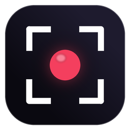

# Rori

A small screen recorder for Windows that lives in the system tray.



## Features

- **F3** — select a region and record it. Press F3 again to stop and save.
- **F12** — save the last 1–60 minutes of both monitors (replay buffer, 60 fps).
- Frame rate from 1 to 720 fps and 1K / 2K / 4K resolution for region recording.
- Computer sound is recorded in both modes.
- Hardware encoding on NVIDIA, AMD and Intel GPUs.
- 15 color themes.

Recordings are saved to `Desktop\Recordings`.

## Download

Get the latest zip from [Releases](../../releases), extract it, and run `Rori.exe`.
Keep `Rori.exe` and `ffmpeg.exe` in the same folder.

Requires Windows 10 or 11, 64-bit.

## Build

```
dotnet publish Rori.csproj -c Release -o publish
```

Place `ffmpeg.exe` next to `Rori.exe`.

## Third-party

Rori uses [FFmpeg](https://ffmpeg.org) (GPLv3 build, shipped in the release zip with its license) and [NAudio](https://github.com/naudio/NAudio).
